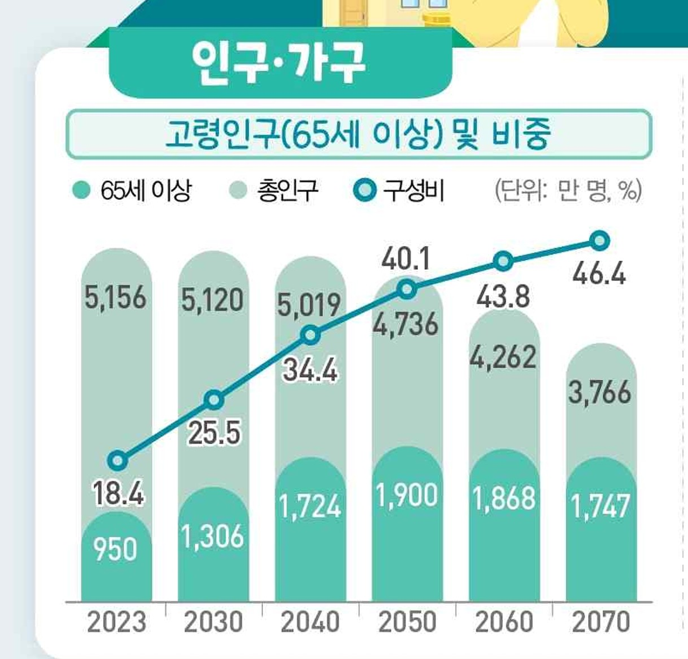
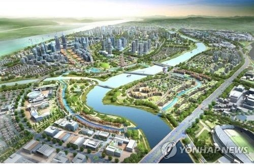

> 현재는 보고서 틀을 준비한 단계이며, 아래 초록과 연구 배경은 우리 조의 최종 작성 본문입니다.

## 초록

본 연구는 부산 에코델타시티를 대상으로 개발 전후 하절기의 지표면 온도(LST) 변화를 파악하고, 수변 및 녹지의 거리별 냉각 효과를 산출하였다. Landsat 8·9 위성영상 분석 결과, 농경지가 시가지와 나지로 전환된 구역에서 뚜렷한 LST 상승이 나타났으며, 시가지화 지수(NDBI)와 LST 변화량 간에 강한 양의 선형관계(r=+0.805)가 확인되었다. NDBI를 통제한 낙동강 수변은 개발 후 강에서 100m 멀어질 때 약 +0.4~0.6℃의 온도 상승 구배를 보였으며, 그 냉각 영향 범위는 수변으로부터 약 200m 안팎으로 도출되었다. 또한, NDBI를 단일 통제변수로 설정한 내부 녹지 분석에서도 녹지는 개발 후 경계에서 100m 멀어질 때 보정 LST가 약 +0.581℃ 상승하는 선형 추세가 확인되었다. 본 연구는 향후 신도시 개발 과정에서 열환경 악화를 완화하기 위한 수변 및 녹지의 효과적인 공간 배치와 적정 이격 거리에 대한 실증적 시사점을 제공한다.

**주제어:** 부산 에코델타시티, 지표면 온도(LST), 시가지화 지수(NDBI), 정규식생지수(NDVI), 거리별 냉각 효과, 통제변수

## 1. 연구 배경

### 1.1 열환경은 왜 공공 문제인가
최근 기후변화로 인해 기온 상승 및 폭염 발생이 심화되고 있으며, 이러한 현상은 불투수면이 밀집된 도시 공간에서 더욱 뚜렷하게 나타난다. 실제로 기상청(2023)의 8월 기후 동향에 따르면, 2023년 8월 전국 평균기온은 평년보다 1.3℃ 높았으며, 하순에는 덥고 습한 바람이 유입되어 고온 현상이 지속되었다. 열환경의 악화는 단순한 불쾌감을 넘어 시민의 생존을 위협하는 공공 보건의 문제로 직결된다. 통계청(2023)에 따르면 2023년 기준 우리나라의 65세 이상 인구 비율은 18.4%에 달해 초고령사회 진입을 눈앞에 두고 있으며, 2050년에는 이 비율이 40.1%를 초과할 것으로 전망된다. 고령자는 폭염에 극히 취약한데, 질병관리청(2023년 온열질환 응급실감시체계 운영 결과 보고서)에 따르면 2023년 온열질환 추정 사망자는 전년 대비 255.6% 급증하였으며, 인구 10만 명당 발생 환자 수는 80세 이상(11.5명) 등 고령층으로 갈수록 급격히 높아지는 경향을 보였다. 이에 따라 폭염은 2018년 재난안전법 개정을 통해 국가가 관리하는 자연재난으로 지정되었다. 나아가 정부는 제4차 국가 기후위기 적응대책에서 국토공간 전반의 기후회복력 제고와 취약계층 보호를 과제로 제시하였으며, 열환경 관리는 이를 위한 공간 계획의 대상이 되고 있다. 다만, 본 연구에서 다루는 지표면 온도(LST)는 지표의 온도이므로 기온이나 인체의 열 노출과 동일하게 해석해서는 안 되며, 본 연구는 이를 열환경 변화의 공간적 지표로 사용한다.

<table align="center" style="border: none;">
  <tr>
    <td align="center" width="50%" style="border: none;">
      
    </td>
    <td align="center" width="50%" style="border: none;">
      
    </td>
  </tr>
  <tr>
    <td align="center" style="border: none;">
      그림 1. 2023년 8월 기온 시계열 (출처: 기상청)
    </td>
    <td align="center" style="border: none;">
      그림 2. 고령인구 비중 추이 (출처: 통계청, 2023)
    </td>
  </tr>
</table>

### 1.2 개발은 열환경을 어떻게 바꾸나
도시화 및 신도시 개발 과정은 필연적으로 대규모 토지피복 변화를 동반한다. 관련 선행 연구(Weng, 2001)에 따르면, 수분을 머금은 자연 식생 및 농경지가 아스팔트나 콘크리트 등 불투수성 인공 매질로 전환되는 현상은 도시 열섬(UHI) 강도를 증폭시키는 핵심 요인 중 하나로 지적된다. 태양 복사에너지를 흡수한 인공 피복이 열을 축적하고 방출하면서 지표면 온도가 비정상적으로 상승하기 때문이다. 따라서 농경지가 도시로 바뀌는 개발 구역에서는 열환경 악화를 최소화하기 위한 사전적 공간 계획이 요구된다.

### 1.3 수변·녹지는 완화 수단인데 무엇이 비어 있나
열환경 완화를 위한 대표적인 도시계획 수단은 수변 공간과 녹지의 조성이다. 수변·녹지 주변의 온도가 낮다는 연구는 많지만, 냉각이 미치는 거리와 크기는 연구마다 다르고, 주변 토지피복과 시가지화 수준의 차이를 함께 고려한 연구는 상대적으로 적다. 따라서 실제 대규모 토지피복 변화가 일어나는 대상지에서 이를 직접 확인할 필요가 있다. 본 연구는 시가지화 수준 등 주변 환경 요인을 통제한 상태에서 수변·녹지로부터의 거리별 온도 차이 범위와 크기를 객관적 수치로 산출하고자 한다.

### 1.4 왜 에코델타시티인가

   
  에코델타시티 조감도 (출처: 부산광역시포털사이트)

부산 에코델타시티는 낙동강 하구에 위치한 수변 중심 친수구역이자 스마트시티 국가시범도시로 조성되고 있다(K-water). 동시에 현재 대규모 농경지가 시가지로 전환되고 있는 진행형 개발 구역이기도 하다. 즉, 에코델타시티는 토지피복 변화로 인한 열환경 악화 현상과 수변·녹지의 냉각 효과를 동일 구역 내에서 명확하게 대조하여 관측할 수 있는 최적의 대상지이다. 이에 본 연구는 에코델타시티를 대상으로 개발 전후의 위성영상 데이터를 활용하여 도시 개발에 따른 전반적인 열환경 변화 양상을 파악하고, 공간 내 수변·녹지가 주변 온도를 낮추는 냉각 효과를 관측 기반으로 분석한다. 본 연구는 관측 자료에 기반한 통계적 분석으로 건강 피해 감소나 인과효과를 입증하지 않으며, 온도 차이의 범위와 크기를 제시하여 공간계획 검토의 기초 자료로 활용하는 데 목적이 있다.

## 2. 연구 질문

연구 배경의 문제를 다음 세 질문으로 구체화하였다. 일상적 질문은 문제의식을 표현하고, 학술적 연구 질문은 비교 대상과 조건을 명시한다. 질문 1–3은 다음 절의 세부목적 1–3에 각각 대응한다.

### 2.1 연구 질문 1

> **일상적 질문:** “에코델타시티는 개발되면서 정말 더 더워졌을까? 어떤 곳이 가장 많이 더워졌을까?”

**학술적 연구 질문.** 개발 전(2016·2017년 7월과 8월)과 개발 후(2024·2025년 7월과 8월)의 여름철 지표온도(LST)는 에코델타시티에서 어떻게 달라졌으며, 그 변화는 토지피복 전환 유형(시가지, 나지, 녹지, 수면, 농경지)별로 어떻게 다르고 시가지 지수(NDBI)의 변화와 어떤 관련성을 보이는가?

### 2.2 연구 질문 2

> **일상적 질문:** “강 가까이 있으면 정말 더 시원할까? 그건 강 때문일까, 아니면 주변에 건물이 적어서일까?”

**학술적 연구 질문.** 낙동강 수변으로부터의 거리에 따라 개발 전후의 평균 LST는 어떻게 달라지며, 주변 시가지 수준(NDBI)을 통제한 뒤에도 거리-온도 관계가 남는가? 또한 거리-온도 기울기가 완만해지는 변화점은 개발 전후에 어떻게 달라졌는가?

### 2.3 연구 질문 3

> **일상적 질문:** “녹지 가까이 있으면 정말 더 시원할까? 그건 녹지 때문일까, 아니면 주변에 건물이 적어서일까?”

**학술적 연구 질문.** 녹지 경계로부터 150 m까지의 거리에 따라 개발 전후의 주변 LST는 어떻게 달라지며, 주변 시가지 수준(NDBI)을 통제한 뒤에도 거리-온도 관계가 남는가?

## 3. 연구 목적

### 3.1 전체 연구목적

**본 연구는 개발 전후 두 시기의 Landsat 8·9 영상으로 산출한 여름철 지표온도를 이용하여 에코델타시티의 열환경 변화를 확인하고, 수변과 녹지로부터의 거리에 따른 지표온도 변화를 산출하여 냉각 효과가 나타나는지 살펴보는 것을 목적으로 한다.** 이를 바탕으로 신도시를 개발할 때 수변과 녹지 배치에 참고할 수 있는 시사점을 제시한다. 대상은 관측된 지표온도의 공간적·시간적 연관성이며, 개발이나 수변·녹지 조성이라는 개입의 인과효과는 포함하지 않는다.

세부목적은 서로 이어지도록 구성하였다. 먼저 개발 전후의 지표온도 변화와 시가지 유지 지역의 배경 변화 기준을 확인한다(세부목적 1). 이 결과는 이후 거리별 결과를 해석하는 바탕이 된다. 다음으로 낙동강 수변으로부터의 거리별 지표온도 변화를 산출하고(세부목적 2), 마지막으로 녹지 경계로부터의 거리별 변화를 산출하되 주변 시가지 수준의 영향을 통제한다(세부목적 3). 이 결과를 종합하여 신도시 개발 시사점을 정리한다.

### 3.2 세부목적 1 · 에코델타시티 개발 전후의 지표온도 변화 확인

**연구 질문 1의 목적화.** 개발 전후 에코델타시티의 여름철 지표온도 변화를 토지피복 전환 유형(시가지, 나지, 녹지, 수면, 농경지)별로 비교하고, 변화가 크게 나타난 유형과 NDBI 변화량의 관련성을 파악한다. 시가지로 유지된 지역의 변화량을 배경 변화 기준으로 삼아, 농경지에서 시가지·나지로 바뀐 지역의 상대 상승량을 제시한다.

**필요성 및 평가 지표.** 수변과 녹지의 거리별 변화를 해석하려면 먼저 개발로 열환경이 어디에서 얼마나 달라졌는지에 대한 기준이 필요하다. 두 시기의 촬영일과 기상이 달라 LST 절대값은 직접 비교하기 어려우므로, 시가지로 유지된 지역의 변화량을 배경 변화 기준으로 함께 제시한다. 개발 전후 평균 LST 차이(℃)와 LST 공간 분포, 토지피복 전환 유형별 평균 ΔLST와 표본 수(픽셀 수), NDBI 구간별 평균 LST의 개발 전후 비교, ΔNDBI–ΔLST 단순회귀의 기울기·상관계수·결정계수(R²), 배경 기준을 차감한 상대 상승량을 평가 지표로 사용한다.

### 3.3 세부목적 2 · 낙동강 수변 거리에 따른 육상 지표온도 변화 산출

**연구 질문 2의 목적화.** 낙동강 수변으로부터의 거리에 따른 육상의 평균 지표온도 변화를 개발 전후로 산출하고, 주변 NDBI를 통제한 뒤의 거리-온도 기울기(℃/100 m)와 기울기가 완만해지는 변화점(m)을 도출한다.

**필요성 및 평가 지표.** 강 가까운 곳은 건물과 포장이 적어서 시원할 수 있으므로, 거리와 온도의 관계를 그대로 수변의 냉각 효과로 해석할 수 없다. 따라서 주변 시가지 수준(NDBI)을 통제한 뒤에도 거리-온도 관계가 남는지 확인한다. 이때 물 자체의 낮은 온도가 거리별 평균에 섞이지 않도록 수역(수면) 픽셀은 분석에서 제외하고 육상 픽셀만 사용하며, 주변 NDBI 평균도 수면을 뺀 육상 픽셀로 계산한다. 수변으로부터 30 m 간격 거리 구간별 평균 LST와 표본 수, NDBI 통제 전후 거리계수(100 m당 LST 변화)와 95% 신뢰구간, 거리-온도 기울기가 완만해지는 변화점을 평가 지표로 사용한다.

### 3.4 세부목적 3 · 녹지 경계 거리에 따른 지표온도 변화 산출

**연구 질문 3의 목적화.** 녹지 경계로부터 150 m까지 30 m 간격 거리띠별 평균 지표온도를 개발 전후로 산출하여 거리-온도 기울기(℃/100 m)를 도출하고, 주변 시가지 수준을 통제한 뒤에도 녹지 거리에 따른 냉각 효과가 나타나는지 확인한다.

**필요성 및 평가 지표.** 녹지 주변이 시원해 보이는 것은 녹지 자체뿐 아니라 주변 건물·포장·나지의 유무에도 달려 있어, 거리와 온도의 관계를 그대로 녹지의 냉각 효과로 해석할 수 없다. 따라서 주변 시가지 수준(NDBI)을 통제한 뒤에도 거리–온도 관계가 남는지 확인한다. 녹지(NDVI 0.20 이상)에 해당하는 픽셀은 거리띠에서 제외하고 녹지 바깥의 픽셀만 대상으로 삼는다. 녹지 경계로부터 30 m 간격 거리띠별 평균 LST와 유효 픽셀 수, 개별 픽셀의 거리–LST 산점도, NDBI 통제 전후의 거리계수(100 m당 LST 변화)와 95% 신뢰구간, 결정계수(R²), 가장 가까운 구간과 가장 먼 구간의 평균 LST 차이, 개발 전후 시기별 비교를 평가 지표로 사용한다.
## 4. 재료

Landsat 8·9 Collection 2 Level-2
분석기간: 2016–2017년, 2024–2025년 여름철

## 5. 방법

LST, NDVI, NDBI를 산출하여 비교하고
거리별 회귀분석을 수행하였다.

## 6. 결과

### 6.1 개발 전후 열환경 변화

### 6.2 수변 거리별 LST 분석

NDBI 통제 후 거리계수는 +0.596℃/100m였다.

### 6.3 녹지 거리별 LST 분석

개발 후 R23의 유효 픽셀은 252개였다.

## 7. 토의

## 8. 결론

 

---

## 연구 배경 참고문헌

기상청. (2023). <em>기후분석정보 2023년 8월호</em>. <a href="https://www.kma.go.kr/download_02/ellinonewsletter_2023_08.pdf" target="_blank">https://www.kma.go.kr/download_02/ellinonewsletter_2023_08.pdf</a>  

질병관리청. (2024). <em>2023년 온열질환 응급실감시체계 운영 결과</em>. 주간 건강과 질병, 17(34). <a href="https://www.phwr.org/journal/view.html?doi=10.56786/PHWR.2024.17.34.1" target="_blank">https://doi.org/10.56786/PHWR.2024.17.34.1</a>  

통계청. (2023). <em>2023 고령자 통계보고서pdf</em>.  

기후에너지환경부. (2023). <em>국가 기후위기 적극 대응 대책(제4차 국가 기후위기 적응대책) - 기후 상세 - 정책정보</em>. <a href="https://www.mcee.go.kr" target="_blank">https://www.mcee.go.kr</a>  

Weng, Q. (2001). A remote sensing-GIS evaluation of urban expansion and its impact on surface temperature in the Zhujiang Delta, China. <em>International Journal of Remote Sensing</em>, 22, 1999-2014. - References - Scientific Research Publishing. <a href="https://www.scirp.org" target="_blank">https://www.scirp.org</a>  

부산광역시. (연도미상). <em>부산 에코델타시티 스마트시티 조성사업</em>. 부산광역시 공식 포털사이트. <a href="https://www.busan.go.kr" target="_blank">https://www.busan.go.kr</a>  

