> 현재는 보고서 틀을 준비한 단계이며, 아래 초록과 연구 배경은 우리 조의 최종 작성 본문입니다.

## 초록

본 연구는 부산 에코델타시티를 대상으로 개발 전후 하절기의 지표면 온도(LST) 변화를 파악하고, 수변 및 녹지의 거리별 냉각 효과를 산출하였다. Landsat 8·9 위성영상 분석 결과, 농경지가 시가지와 나지로 전환된 구역에서 뚜렷한 LST 상승이 나타났으며, 시가지화 지수(NDBI)와 LST 변화량 간에 강한 양의 선형관계(r=+0.805)가 확인되었다. NDBI를 통제한 낙동강 수변은 개발 후 강에서 100m 멀어질 때 약 +0.4~0.6℃의 온도 상승 구배를 보였으며, 그 냉각 영향 범위는 수변으로부터 약 200m 안팎으로 도출되었다. 또한, NDBI를 단일 통제변수로 설정한 내부 녹지 분석에서도 녹지는 개발 후 경계에서 100m 멀어질 때 보정 LST가 약 +0.581℃ 상승하는 선형 추세가 확인되었다. 본 연구는 향후 신도시 개발 과정에서 열환경 악화를 완화하기 위한 수변 및 녹지의 효과적인 공간 배치와 적정 이격 거리에 대한 실증적 시사점을 제공한다.

**주제어:** 부산 에코델타시티, 지표면 온도(LST), 시가지화 지수(NDBI), 정규식생지수(NDVI), 거리별 냉각 효과, 통제변수

## 1. 연구 배경

### 1.1 열환경은 왜 공공 문제인가
최근 기후변화로 인해 기온 상승 및 폭염 발생이 심화되고 있으며, 이러한 현상은 불투수면이 밀집된 도시 공간에서 더욱 뚜렷하게 나타난다. 실제로 기상청(2023)의 8월 기후 동향에 따르면, 2023년 8월 전국 평균기온은 평년보다 1.3℃ 높았으며, 하순에는 덥고 습한 바람이 유입되어 고온 현상이 지속되었다. 열환경의 악화는 단순한 불쾌감을 넘어 시민의 생존을 위협하는 공공 보건의 문제로 직결된다. 통계청(2023)에 따르면 2023년 기준 우리나라의 65세 이상 인구 비율은 18.4%에 달해 초고령사회 진입을 눈앞에 두고 있으며, 2050년에는 이 비율이 40.1%를 초과할 것으로 전망된다. 고령자는 폭염에 극히 취약한데, 질병관리청(2023년 온열질환 응급실감시체계 운영 결과 보고서)에 따르면 2023년 온열질환 추정 사망자는 전년 대비 255.6% 급증하였으며, 인구 10만 명당 발생 환자 수는 80세 이상(11.5명) 등 고령층으로 갈수록 급격히 높아지는 경향을 보였다. 이에 따라 폭염은 2018년 재난안전법 개정을 통해 국가가 관리하는 자연재난으로 지정되었다. 나아가 정부는 제4차 국가 기후위기 적응대책에서 국토공간 전반의 기후회복력 제고와 취약계층 보호를 과제로 제시하였으며, 열환경 관리는 이를 위한 핵심 공간 계획의 대상이 되고 있다. 특히 도시 열환경 악화의 주원인이 지표 피복의 변화에 있는 만큼, 토지피복(불투수면·녹지·수변)과 지표면 온도(LST) 간의 정량적 관계를 규명하고 그 온도 저감 효과를 확인하는 것은 실효성 있는 공간 계획을 수립하는 데 필수적이다. 다만, 본 연구에서 다루는 지표면 온도(LST)는 지표의 온도이므로 기온이나 인체의 열 노출과 동일하게 해석해서는 안 되며, 본 연구는 이를 열환경 변화의 공간적 지표로 사용한다.

<table align="center" style="border: none;">
  <tr>
    <td align="center" width="50%" style="border: none;">
      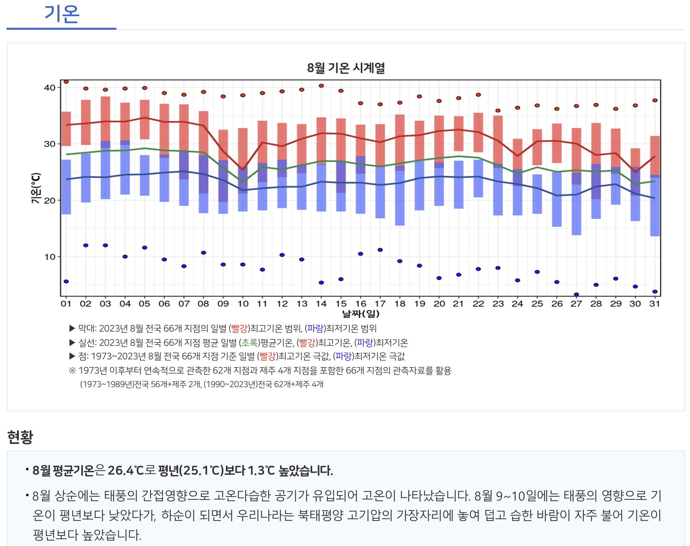
    </td>
    <td align="center" width="50%" style="border: none;">
      
    </td>
  </tr>
  <tr>
    <td align="center" style="border: none;">
      그림 1. 2023년 8월 기온 시계열 (출처: 기상청)
    </td>
    <td align="center" style="border: none;">
      그림 2. 고령인구 비중 추이 (출처: 통계청, 2023)
    </td>
  </tr>
</table>

### 1.2 개발은 열환경을 어떻게 바꾸나
앞선 공공 보건적 위협 속에서 도시화 및 신도시 개발 과정이 수반하는 대규모 토지피복 변화는 열환경을 급격히 악화시키는 직접적인 원인이 된다. 관련 선행 연구(Weng, 2001)에 따르면, 수분을 머금은 자연 식생 및 농경지가 아스팔트나 콘크리트 등 불투수성 인공 매질로 전환되는 현상은 도시 열섬(UHI) 강도를 증폭시키는 핵심 요인이다. 태양 복사에너지를 흡수한 인공 피복이 열을 축적하고 방출하면서 지표면 온도가 비정상적으로 상승하기 때문이다. 즉, 기후위기 시대에 열환경 악화와 그로 인한 취약계층의 피해를 막기 위해서는, 농경지가 도시로 바뀌는 대규모 개발 구역에서 토지피복 변화에 따른 열 상승을 억제할 수 있는 사전적 공간 계획이 필연적으로 요구된다.

### 1.3 수변·녹지는 완화 수단인데 무엇이 비어 있나
열환경 완화를 위한 대표적인 도시계획 수단은 수변 공간과 녹지의 조성이다. 수변·녹지 주변의 온도가 낮다는 연구는 많지만, 냉각이 미치는 거리와 크기는 연구마다 다르고, 주변 토지피복과 시가지화 수준의 차이를 함께 고려한 연구는 상대적으로 적다. 따라서 실제 대규모 토지피복 변화가 일어나는 대상지에서 이를 직접 확인할 필요가 있다. 본 연구는 시가지화 수준 등 주변 환경 요인을 통제한 상태에서 수변·녹지로부터의 거리별 온도 차이 범위와 크기를 객관적 수치로 산출하고자 한다.

### 1.4 왜 에코델타시티인가

   
  에코델타시티 조감도 (출처: 부산광역시포털사이트)

부산 에코델타시티는 낙동강 하구에 위치한 수변 중심 친수구역이자 스마트시티 국가시범도시로 조성되고 있다(K-water). 동시에 현재 대규모 농경지가 시가지로 전환되고 있는 진행형 개발 구역이기도 하다. 즉, 에코델타시티는 토지피복 변화로 인한 열환경 악화 현상과 수변·녹지의 냉각 효과를 동일 구역 내에서 명확하게 대조하여 관측할 수 있는 최적의 대상지이다.이를 분석하기 위해 본 연구는 지상 기상관측자료 대신 위성 원격탐사 자료를 활용한다. 기존 지상 관측망은 관측 지점이 점(Point) 단위로 제한되어 있어, 급격히 변화하는 개발 구역 전체의 연속적인 온도 분포와 공간적 패턴을 파악하는 데 한계가 있기 때문이다. 특히 Landsat 8·9 Collection 2 Level-2 자료는 광역적인 지표면 온도(LST)와 지표반사도 정보를 함께 제공하므로, 동일 시기의 영상에서 토지피복 특성과 시가지화 수준을 나타내는 분광지수(NDVI, NDBI 등)를 동시에 산출할 수 있다. 이에 본 연구는 위성영상을 활용하여 도시 개발에 따른 전반적인 열환경 변화 양상을 파악하고, 시가지화 수준을 통제한 상태에서 수변·녹지가 주변 온도를 낮추는 냉각 효과를 정량적으로 분석한다. 본 연구는 관측 자료에 기반한 통계적 분석으로 건강 피해 감소나 인과효과를 입증하지 않으며, 온도 차이의 범위와 크기를 제시하여 공간계획 검토의 기초 자료로 활용하는 데 목적이 있다.

## 2. 연구 질문

부산 에코델타시티를 대상으로, 개발 전후 지표면 온도(LST)의 변화와 수변·녹지의 거리별 냉각 효과를 다음 세 질문으로 구체화하였다.

### 2.1 연구 질문 1

> **일상적 질문:** “에코델타시티는 개발되면서 온도가 어떻게 달라졌을까? 어떤 곳이 가장 많이 달라졌을까?”

**학술적 연구 질문.** 개발 초기(2016·2017년 7월과 8월)과 개발 후기(2024·2025년 7월과 8월)의 여름철 지표온도(LST)는 에코델타시티에서 어떻게 달라졌으며, 그 변화는 토지피복 유형(시가지, 나지, 녹지, 수면, 농경지) 및 토지피복 전환 유형별로 어떻게 다르고 시가지 지수(NDBI)의 변화와 어떤 관련성을 보이는가?

### 2.2 연구 질문 2

> **일상적 질문:** “강 가까이 있으면 온도가 어떠할까? 그건 강 때문일까, 아니면 주변에 건물이 적어서일까?”

**학술적 연구 질문.** 낙동강 수변으로부터의 거리에 따라 개발 초기,후기의 평균 LST는 어떻게 달라지며, 주변 시가지 수준(NDBI)을 통제한 뒤에도 거리-온도 관계가 남는가? 또한 거리-온도 기울기가 완만해지는 변화점은 개발 전후에 어떻게 달라졌는가?

### 2.3 연구 질문 3

> **일상적 질문:** “녹지 가까이 있으면 온도가 어떠할까? 그건 녹지 때문일까, 아니면 주변에 건물이 적어서일까?”

**학술적 연구 질문.** 녹지 경계로부터 150 m까지의 거리에 따라 개발 초기,후기의 주변 LST는 어떻게 달라지며, 주변 시가지 수준(NDBI)을 통제한 뒤에도 거리-온도 관계가 남는가?

## 3. 연구 목적

### 3.1 전체 연구목적

**본 연구는 개발 초기,후기 두 시기의 Landsat 8·9 영상으로 산출한 여름철 지표온도를 이용하여 에코델타시티의 열환경 변화를 확인하고, 수변과 녹지로부터의 거리에 따른 지표온도 변화를 산출하여 냉각 효과가 나타나는지 살펴보는 것을 목적으로 한다.** 이를 바탕으로 신도시의 수변과 녹지 배치를 검토할 때 참고할 수 있는 기초 자료를 제시한다. 대상은 관측된 지표온도의 공간적·시간적 연관성이다.

세부목적은 서로 이어지도록 구성하였다. 먼저 개발 초기,후기의 지표온도 변화와 시가지 유지 지역의 배경 변화 기준을 확인한다(세부목적 1). 이 결과는 이후 거리별 결과를 해석하는 바탕이 된다. 다음으로 낙동강 수변으로부터의 거리별 지표온도 변화를 주변 시가지 수준(NDBI)의 영향을 통제하여 산출하고(세부목적 2), 마지막으로 녹지 경계로부터의 거리별 변화를 같은 방식으로 산출한다(세부목적 3). 이 결과를 종합하여 신도시의 수변·녹지 배치에 참고할 수 있는 사항을 정리한다.

### 3.2 세부목적 1 · 에코델타시티 개발 전후의 지표온도 변화 확인

**연구 질문 1의 목적화.** 개발 초기,후기 에코델타시티의 여름철 지표온도 변화를 토지피복 유형(시가지, 나지, 녹지, 수면, 농경지) 및 토지피복 전환 유형별로 비교하고, 변화가 크게 나타난 유형과 NDBI 변화량의 관련성을 파악한다. 시가지로 유지된 지역의 변화량을 배경 변화 기준으로 삼아, 농경지에서 시가지·나지로 바뀐 지역의 상대 상승량을 제시한다.

**필요성 및 평가 지표.** 수변과 녹지의 거리별 변화를 해석하려면 먼저 개발로 열환경이 어디에서 얼마나 달라졌는지에 대한 기준이 필요하다. 두 시기의 촬영일과 기상이 달라 LST 절대값은 직접 비교하기 어려우므로, 시가지로 유지된 지역의 변화량을 배경 변화 기준으로 함께 제시한다. 개발 초기,후기 평균 LST 차이(℃)와 LST 공간 분포, 토지피복 전환 유형별 평균 ΔLST와 표본 수(픽셀 수), NDBI 구간별 평균 LST의 개발 전후 비교, ΔNDBI–ΔLST 단순회귀의 기울기·상관계수·결정계수(R²), 배경 기준을 차감한 상대 상승량을 평가 지표로 사용한다.

### 3.3 세부목적 2 · 낙동강 수변 거리에 따른 육상 지표온도 변화 산출

**연구 질문 2의 목적화.** 낙동강 수변으로부터의 거리에 따른 육상의 평균 지표온도 변화를 개발 초기,후기로 산출하고, 주변 NDBI를 통제한 뒤의 거리-온도 기울기(℃/100 m)와 기울기가 완만해지는 변화점(m)을 도출한다.

**필요성 및 평가 지표.** 강 인근의 지표온도는 거리뿐 아니라 주변의 건물 피복과 불투수면 비율에도 영향을 받는 것으로 보고되어 있어(Kirschner et al., 2024), 거리와 온도의 관계를 그대로 수변의 냉각 효과로 해석할 수 없다. 따라서 주변 시가지 수준(NDBI)을 통제한 뒤에도 거리-온도 관계가 남는지 확인한다. 이때 물 자체의 낮은 온도가 거리별 평균에 섞이지 않도록 수역(수면) 픽셀은 분석에서 제외하고 육상 픽셀만 사용하며, 주변 NDBI 평균도 수면을 뺀 육상 픽셀로 계산한다. 수변으로부터 30 m 간격 거리 구간별 평균 LST와 표본 수, NDBI 통제 전후 거리계수(100 m당 LST 변화)와 95% 신뢰구간, 거리-온도 기울기가 완만해지는 변화점을 평가 지표로 사용한다.

### 3.4 세부목적 3 · 녹지 경계 거리에 따른 지표온도 변화 산출

**연구 질문 3의 목적화.** 녹지 경계로부터 150 m까지 30 m 간격 거리띠별 평균 지표온도를 개발 초기,후기로 산출하여 거리-온도 기울기(℃/100 m)를 도출하고, 주변 시가지 수준을 통제한 뒤에도 녹지 거리에 따른 냉각 효과가 나타나는지 확인한다.

**필요성 및 평가 지표.** 녹지 인근의 지표온도 역시 거리뿐 아니라 주변의 건물 피복과 불투수면 비율에도 영향을 받는 것으로 보고되어 있어(Kirschner et al., 2024), 거리와 온도의 관계를 그대로 녹지의 냉각 효과로 해석할 수 없다. 따라서 주변 시가지 수준(NDBI)을 통제한 뒤에도 거리–온도 관계가 남는지 확인한다. 녹지(NDVI 0.20 이상)에 해당하는 픽셀은 거리띠에서 제외하고 녹지 바깥의 픽셀만 대상으로 삼는다. 녹지 경계로부터 30 m 간격 거리띠별 평균 LST와 유효 픽셀 수, 개별 픽셀의 거리–LST 산점도, NDBI 통제 전후의 거리계수(100 m당 LST 변화)와 95% 신뢰구간, 결정계수(R²), 가장 가까운 구간과 가장 먼 구간의 평균 LST 차이, 개발 전후 시기별 비교를 평가 지표로 사용한다.

<table align="center" style="border: none;">
  <tr>
    <td align="center" width="85%" style="border: none;">
      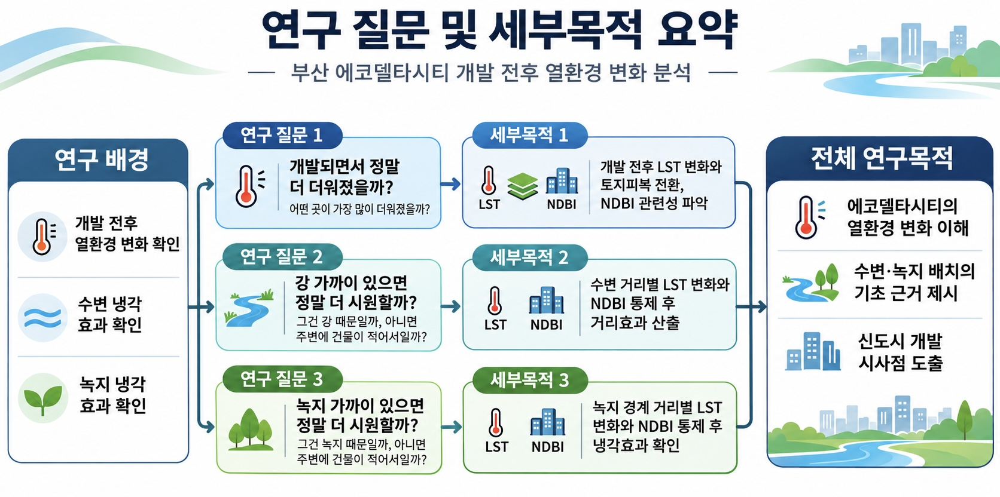
    </td>
  </tr>
  <tr>
    <td align="center" style="border: none;">
      그림 3. 연구 질문 및 세부목적 요약
    </td>
  </tr>
</table>

https://github.com/kimeunbyeol244/surveying-final-project-6/blob/main/docs/index.md

## 4. 재료 (Materials)

### 4.1 연구 대상 지역 및 분석 기간
본 연구의 대상지는 부산광역시 강서구 에코델타시티의 일부 지역이다. 수변·녹지 거리 분석의 공통 연구 범위는 북서쪽(35.1581°N, 128.9021°E)과 남동쪽(35.1386°N, 128.9196°E)을 경계로 하는 약 3.45km²의 직사각형 구역으로 설정하였다. 이 지역은 농경지를 중심으로 도시개발이 진행되면서 시가지, 나지, 녹지와 수면이 혼재하는 곳으로, 개발 전후의 지표면 특성을 비교하기에 적합하다. 그림 4-1은 분석 경계의 두 기준 좌표를 이용해 연구 범위를 시각화한 그림이다.

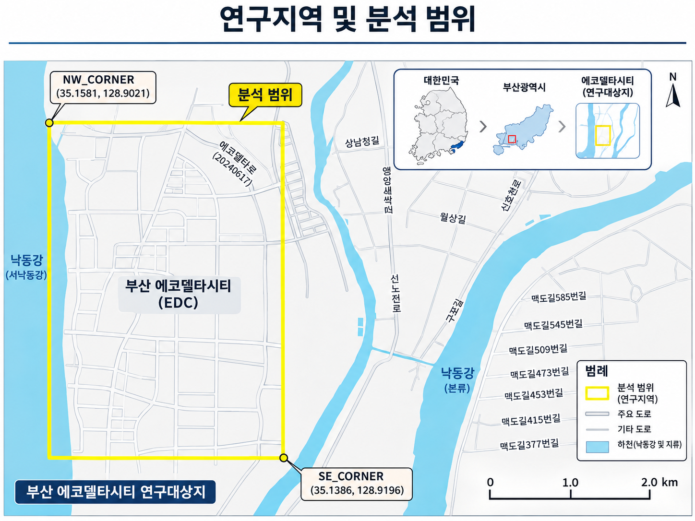

그림 4-1. 부산 에코델타시티 연구지역 및 분석 경계(좌표 기준 개략도)

※ 그림의 직사각형 경계는 분석 좌표를 설명하기 위한 것이며, 배경 도로·하천 및 지형은 실제 GEE 지도에서 직접 추출한 자료가 아닌 개략적 표현이다. 연구지역의 정확한 위치 확인에는 GEE의 경계 레이어 또는 좌표 자료를 사용한다.

관측 시기는 개발 초기인 2016–2017년과 최근인 2024–2025년으로 구분하였다. 개발 초기와 개발이 진행된 최근 시기를 비교함으로써 토지피복과 지표온도의 장기적인 변화를 살펴보고자 하였다. 또한 한 해의 단일 영상에만 의존하지 않고 각 시기에서 2개 연도의 자료를 확보하여 특정 촬영일의 영향이 지나치게 커지는 것을 줄이고자 하였다.

계절은 두 시기 모두 7–8월로 통일하였다. 여름철은 일사에 따른 지표면 가열이 활발하여 토지피복에 따른 지표온도 차이가 비교적 뚜렷하게 나타날 수 있기 때문이다. 동일한 계절을 비교하여 계절 변화의 영향을 줄이되, 촬영일별 기상 조건이 완전히 같지는 않다는 점을 해석에 반영하였다. 녹지 거리 분석은 이 연구 범위 안에서 별도로 설정한 녹지 분석 대상 구역(중심 좌표 35.1483°N, 128.9152°E)을 대상으로 수행하였다. 이하에서는 해당 구역을 동일한 명칭으로 표기한다.

### 4.2 사용 자료와 선정 이유
본 연구에서 활용한 주요 원자료는 Landsat 8·9 Collection 2 Tier 1 Level-2 위성영상과 Dynamic World V1 토지피복 자료이다. 모든 자료는 Google Earth Engine(GEE)을 이용하여 수집·처리하였다. LST와 NDVI·NDBI·MNDWI는 별도로 선정한 원자료가 아니라 Landsat 영상에서 얻거나 계산한 분석 지표로 구분하였다.

① Landsat 8·9 위성영상

Landsat Level-2 자료는 지표면온도(ST_B10)와 지표면반사도 자료를 함께 제공한다. 본 연구에서는 지표면온도를 이용해 개발 전후 및 거리별 LST를 비교하고, 파장별 반사도로부터 NDVI·NDBI·MNDWI를 산출하였다. Landsat을 선정한 이유는 2016–2017년부터 2024–2025년까지 연속적인 관측자료를 확보할 수 있고, 동일한 자료 체계에서 온도와 분광 특성을 함께 살펴볼 수 있기 때문이다. 특히 세부목적 1의 개발 전후 비교에서는 센서 차이를 줄이기 위해 Landsat 8 자료를 동일하게 사용하였다.

② Dynamic World V1 토지피복 자료

Dynamic World V1은 Sentinel-2 영상에 기반한 토지피복 분류자료이다. 연구에서는 이를 시가지, 나지, 녹지, 수면, 농경지의 다섯 유형으로 정리하여 개발 초기와 최근의 토지피복을 비교하였다. NDBI는 시가지와 관련된 분광 특성을 보여주지만, 흙이 노출된 나지에서도 높은 값이 나타날 수 있다. 따라서 시가지화 지수만으로 토지피복을 단정하지 않고 Dynamic World 분류자료를 함께 사용하여 실제 피복 전환 유형을 구분하였다.

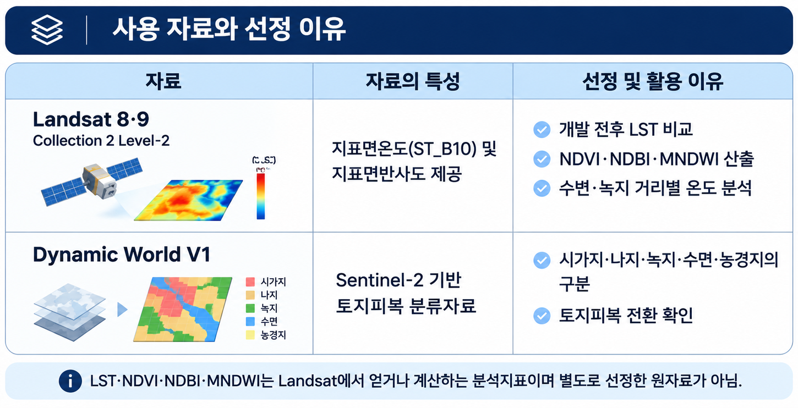

그림 4-2. Landsat 및 Dynamic World의 자료 특성과 선정 이유

### 4.3 세부 연구목적별 자료 활용
세부목적 1에서는 Landsat의 LST·NDBI 자료와 Dynamic World 토지피복 자료를 함께 사용하여 동일 위치의 개발 전후 온도 변화와 피복 전환을 분석한다. 세부목적 2에서는 Landsat의 MNDWI로 낙동강 수역을 판별하고, LST와 NDBI를 이용하여 수변 거리와 온도의 관계 및 주변 시가지화 수준을 분석한다. 세부목적 3에서는 Landsat에서 산출한 NDVI로 녹지 경계를 정하고, 녹지 바깥 픽셀의 거리별 LST와 NDBI를 비교한다. 이처럼 각 자료의 역할을 연구목적에 맞추어 구분하였다.

### 4.4 사용 자료의 한계
Landsat 지표면온도 자료는 30m 격자로 제공되지만, 열적외선 관측의 원래 공간 해상도는 이보다 거칠다. 따라서 개별 건물, 좁은 수변 또는 작은 녹지의 온도 차이를 세밀하게 판별하는 데 제약이 있다. 또한 개발 초기와 최근은 촬영 시점과 당시의 기상 조건이 다르므로, 관측된 LST 변화 전체를 도시개발의 효과로 해석할 수 없다.

Dynamic World의 토지피복 분류에는 오분류 가능성이 있고 Landsat과 원래 공간 해상도도 다르므로, 동일 격자에서 비교할 때 주의가 필요하다. NDBI 역시 불투수면 면적을 직접 측정한 값이 아니라 시가지화 관련 분광 특성의 대리지표이며, NDVI 기준으로 선정한 녹지 후보에도 분류 오차가 있을 수 있다.

녹지 분석 대상 구역은 낙동강 양측 수변의 영향 범위로 설정한 200m 구역 밖에 위치하는 것으로 판단하였다. 이에 따라 녹지 거리 분석에서는 수변의 온도 영향이 크지 않을 것으로 보고 별도의 수역 제외나 수변 거리 보정을 적용하지 않았다. 다만 범위 밖에서도 수변 영향이 완전히 사라진다고 입증된 것은 아니다.

## 5. 방법 (Methods)

### 5.1 위성영상 수집 및 공통 전처리
GEE에서 연구지역을 설정하고 2016–2017년 및 2024–2025년의 7–8월 Landsat Level-2 위성영상을 수집하였다. 수변 및 녹지 거리 분석에서는 구름 피복률 20% 이하의 영상을 대상으로 하며, Landsat 품질정보(QA_PIXEL) 등을 이용하여 구름과 그림자, 기타 유효하지 않은 관측 픽셀을 제거한다. 이 과정을 통해 실제 지표면 대신 구름 등이 관측된 위치가 온도와 분광지수 계산에 포함되지 않도록 하였다.

광학 밴드에는 자료에서 제공하는 스케일과 오프셋을 적용하여 지표면반사도를 계산하고, ST_B10 밴드는 섭씨온도로 변환하여 지표면온도(LST)를 산출한다.

<strong>SR = DN × 0.0000275 − 0.2</strong>

<strong>LST(°C) = ST_B10 × 0.00341802 + 149.0 − 273.15</strong>

여기서 SR은 지표면반사도, DN은 원자료 값이다. 변환한 반사도의 적색광(Red), 녹색광(Green), 근적외선(NIR), 단파적외선(SWIR1) 밴드를 이용하여 NDVI·NDBI·MNDWI를 계산한다.

<strong>NDVI = (NIR − Red) / (NIR + Red)</strong>

<strong>NDBI = (SWIR1 − NIR) / (SWIR1 + NIR)</strong>

<strong>MNDWI = (Green − SWIR1) / (Green + SWIR1)</strong>

NDVI는 녹지 후보 추출에, NDBI는 시가지화 특성의 비교와 회귀보정에, MNDWI는 낙동강 수역 판별에 사용한다. 전처리한 영상을 시기별로 합성하고 공통 분석 격자에 맞춘다. 세부목적 1의 비교에서는 각 연도의 유효 관측값을 중앙값으로 합성한 뒤, 개발 초기 2개 연도와 최근 2개 연도의 영상을 각각 평균하여 대표값을 구성한다. 이후 두 시기 모두 유효한 위치를 비교 대상으로 설정한다.

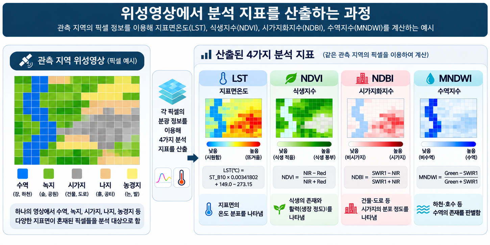

그림 5-1. Landsat 위성영상으로부터 네 가지 분석 지표를 산출하는 과정

### 5.2 세부목적 1 · 개발 전후 토지피복 및 지표온도 변화 비교
토지피복 분류 및 전환 구역 판별

Dynamic World V1의 토지피복 분류를 시가지, 나지, 녹지, 수면, 농경지의 다섯 유형으로 재분류한다. 개발 초기와 최근의 분류도를 동일한 위치에서 중첩하여 농경지→시가지, 농경지→나지, 시가지 유지 등 픽셀별 전환 유형을 구분한다. 각 유형에 속하는 픽셀 면적을 합산하여 피복 변화 면적(km²)을 계산하며, 전환 위치를 지도에 표시하여 도시개발에 따른 공간적 변화를 확인한다.

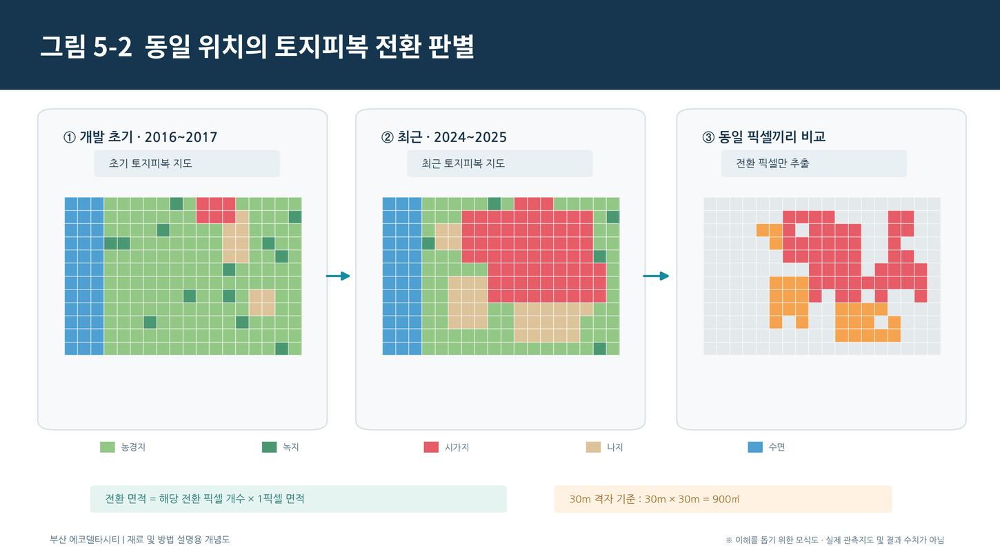

그림 5-2. 개발 전후 동일 위치에서 토지피복 전환을 판별하는 과정

지표온도·시가지화 변화량과 회귀분석

개발 전후 온도와 시가지화 관련 특성의 변화를 같은 위치에서 비교하기 위해 최근값에서 초기값을 뺀 변화량을 계산한다.

<strong>ΔLSTi = LST최근,i − LST초기,i</strong>

<strong>ΔNDBIi = NDBI최근,i − NDBI초기,i</strong>

각 픽셀의 ΔNDBI를 설명변수, ΔLST를 종속변수로 하여 산점도를 작성하고 피어슨 상관계수와 최소제곱법(OLS) 기반 단순회귀분석을 실시한다.

<strong>ΔLSTi = α + β1 × ΔNDBIi + εi</strong>

회귀계수 β₁은 NDBI 변화량과 지표온도 변화량의 관계를 나타낸다. 아울러 토지피복이 유지된 지역과 시가지·나지 등으로 전환된 지역의 평균 ΔLST를 비교하여, 전환 유형에 따라 관측된 온도 변화가 어떻게 달라지는지 살펴본다. 다만 이러한 비교와 회귀분석은 두 변수 사이의 통계적 관계를 설명하는 것이며 인과효과를 직접 입증하는 것은 아니다.

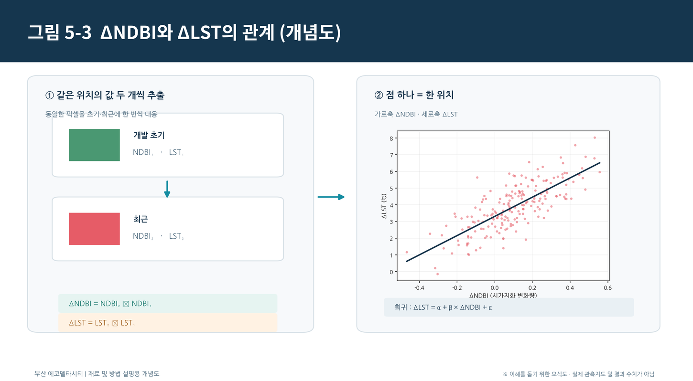

그림 5-3. NDBI 변화량과 LST 변화량의 산점도·회귀분석 개념도

### 5.3 세부목적 2 · 낙동강 수변의 거리별 냉각 효과 산출
수역 추출 및 30m 거리 구간 설정

낙동강 수변에서 떨어진 거리와 육상 지표온도의 관계를 분석하기 위해 MNDWI가 0보다 큰 픽셀을 수역 후보로 설정한다. 이 중 서로 연결된 픽셀이 256개 이상인 큰 수체를 낙동강 수역으로 구분한다. 추출한 수변 경계에서 육상 픽셀까지의 최근접 거리를 계산하고, 0–30m, 30–60m, 60–90m 등 30m 간격의 거리 구간을 설정하여 각 구간의 평균 LST를 구한다. 수면 픽셀은 육상 평균 LST 계산에서 제외한다.

주변 NDBI 보정

수변에서 멀리 떨어진 지역은 건물·도로·나지 등의 분포도 다를 수 있으므로, 거리 효과와 주변 지표피복의 차이를 구분하기 위해 각 육상 픽셀을 중심으로 반경 90m의 평균 NDBI(NDBI_nb)를 계산한다. 주변 NDBI를 계산할 때 수면 픽셀을 제외한 경우를 기본 분석으로 사용하고, 수면을 포함한 경우는 민감도 비교에 활용한다. 이후 수변 거리만 고려한 모형과 NDBI를 함께 포함한 모형을 비교한다.

<strong>LSTi = α + β1 × disti + εi</strong>

<strong>LSTi = α + β1 × disti + β2 × NDBInb,i + εi</strong>

이때 α는 절편이고 β₁·β₂는 각각 거리와 주변 NDBI에 대한 회귀계수이다. 추정된 NDBI 계수로 개별 픽셀의 주변 NDBI를 표본 평균 수준으로 조정한 LST를 계산한 뒤, 보정 전·후의 거리별 평균온도를 비교한다.

<strong>LST보정,i = LST관측,i − β2 × (NDBInb,i − 평균 NDBInb)</strong>

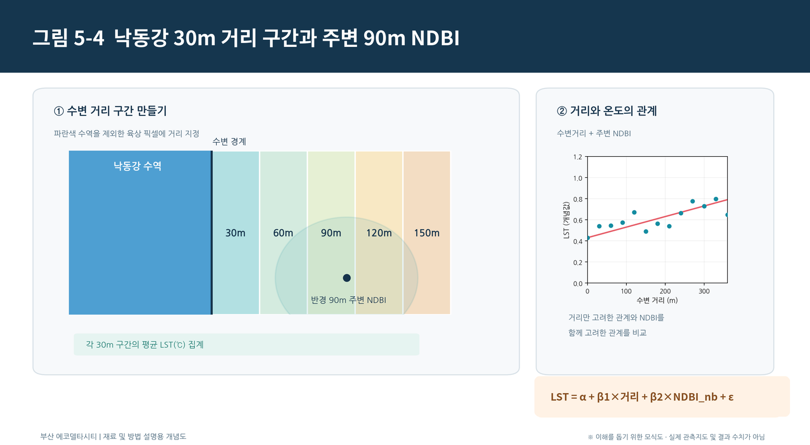

그림 5-4. 수변 30m 거리 구간과 반경 90m 주변 NDBI 계산 개념도

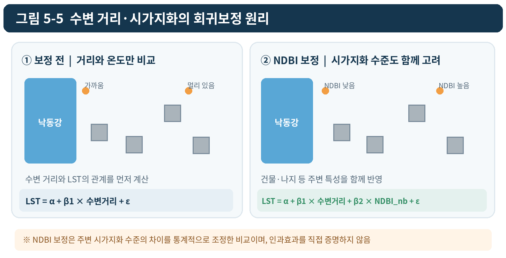

그림 5-5. NDBI를 고려한 수변 거리 회귀보정 원리

냉각 영향 범위 추정

수변으로부터 멀어질 때 지표온도 변화가 완만해지는 거리를 탐색하기 위해 절단거리 변수 min(dist, d₀)를 이용한다. d₀를 60–360m 범위에서 30m 간격으로 바꾸어 모형을 적합하고, 잔차제곱합이 가장 작은 후보 거리를 선택한다. 또한 인접 픽셀의 유사성을 고려하여 약 150m 공간 블록 단위의 군집 표준오차를 적용한다. 이 거리값은 관측자료와 모형에 근거한 추정치로, 실제 공기 온도의 냉각 범위를 직접 측정한 값은 아니다.

### 5.4 세부목적 3 · 녹지의 거리별 냉각 효과 산출
녹지 후보 추출 및 거리 구간 설정

녹지 분석 대상 구역에서 NDVI가 0.20 이상인 픽셀을 녹지 후보로 정하고, 녹지 경계 바깥의 각 픽셀에서 가장 가까운 녹지 경계까지의 거리를 계산한다. 거리 구간은 0–150m 범위에서 30m 간격으로 구분하여 각 구간의 평균 LST를 산출한다. 본 분석은 녹지 내부보다 녹지 주변 지표면의 온도 변화에 초점을 두므로, 녹지 자체에 해당하는 픽셀만 분석 대상에서 제외한다.

NDBI만을 이용한 통계적 보정

녹지와의 거리 외에도 시가지화 관련 지표면 특성이 온도에 영향을 줄 수 있으므로, NDBI만을 추가 보정변수로 사용한다. 녹지 경계와의 거리 및 NDBI를 설명변수로 하는 회귀모형을 적용하고, NDBI 차이를 통계적으로 조정한 후 거리별 평균 LST를 보정 전 값과 비교한다. NDVI는 녹지 후보를 추출하는 데 활용하며, 식생 수준별 등급을 별도로 나누어 비교하지 않는다.

<strong>LSTi = α + β1 × dist녹지,i + β2 × NDBIi + εi</strong>

<strong>LST보정,i = LST관측,i − β2 × (NDBIi − 평균 NDBI)</strong>

녹지 분석 대상 구역은 연구팀이 수변의 영향 범위로 가정한 낙동강 양측 수변의 200m 구역 밖에 있는 것으로 판단하였다. 따라서 이 구역에서는 수변의 영향이 크지 않을 것으로 보고, 수역 픽셀을 별도로 제외하거나 수변 거리를 회귀모형에 추가하지 않았다. 이는 분석 대상 구역의 위치와 연구에서 정한 거리 기준에 따른 판단으로, 수변 영향이 완전히 없다는 사실을 직접 검증한 것은 아니다. 거리별 냉각 경향이 뚜렷하지 않으면 냉각 범위를 임의로 확정하지 않는다.

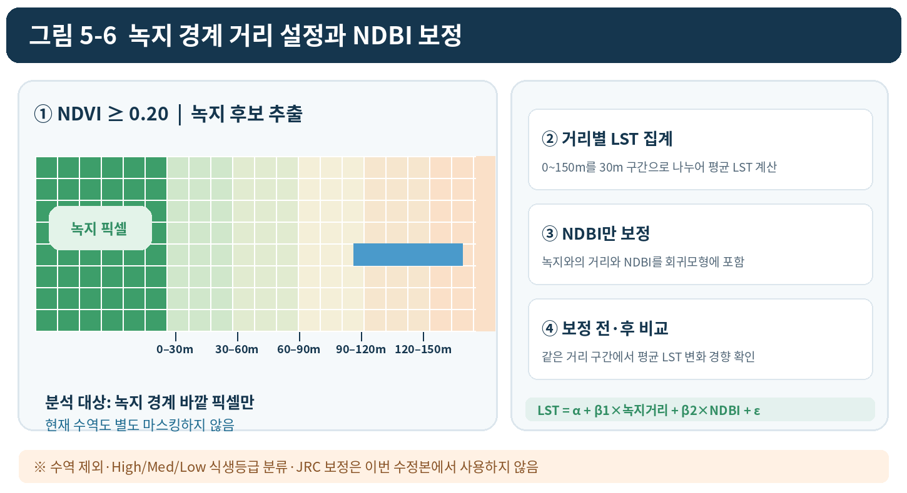

그림 5-6. 녹지 경계 거리 구간 설정과 NDBI 보정 개념도

### 5.5 관측자료의 오차 점검 및 재현성 확보
개발 초기와 최근의 비교에서는 두 시기 모두 유효한 값이 존재하는 동일 위치를 사용한다. 구름과 그림자, 결측 픽셀을 제외하고, 토지피복 전환 지역은 Dynamic World 분류 결과와 원영상을 대조하여 주요 분류 상태를 점검한다. 수변·녹지 거리 분석에서는 각 거리 구간에 포함된 유효 픽셀 수와 면적을 기록하여 표본이 적은 구간을 확인한다.

또한 Landsat의 열적외선 공간 해상도, 서로 다른 관측일의 기상 조건, NDBI가 불투수면의 직접 측정값이 아니라는 한계 등을 고려하여 분석 결과를 해석한다. 회귀보정으로 얻은 온도 차이는 환경변수 수준을 통계적으로 맞춘 비교값일 뿐, 개별 요인의 순수한 냉각 효과를 직접 입증하는 값은 아니다.

마지막으로 연구 경계와 분석 기간, 사용 위성영상의 촬영일 및 제품 식별자, 품질 마스크 기준, 영상 합성 방식, 지수 계산식, 거리 구간과 회귀모형 설정을 GEE 코드와 함께 기록하여 동일한 절차를 재현할 수 있도록 한다.

## 6. 결과 {#results}

### 6.0 기초 탐색 분석
개발 전(2016–2017년)과 개발 후(2024–2025년)의 7–8월 Landsat 영상은 각각 6장, Dynamic World V1 영상은 각각 7장과 26장이 확보되었다. 수변 및 녹지 거리별 분석에는 개발 전 2장, 개발 후 6장의 Landsat 영상이 사용되었다.

전체 연구대상지 면적은 약 3.450km²이며, 개발 전후 공통 유효 LST 분석 면적은 3.224km²로 전체 면적의 약 93.46%에 해당하였다. LST, NDBI, NDVI가 두 시기 모두 유효한 936개의 공간 표본을 대상으로 기초통계량을 산출하고 개발 전후 자료의 분포를 비교하였다.

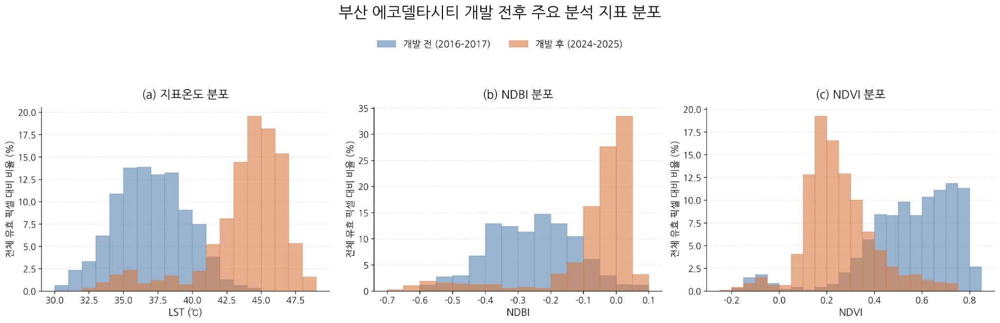

그림 6-1. 부산 에코델타시티 개발 전후 주요 분석 지표의 분포

개발 전후 평균 LST는 36.990℃에서 43.844℃로 6.854℃ 증가하였으며, 표준편차는 2.612℃에서 3.089℃로 증가하였다. 지표온도 분포는 개발 전 35–39℃ 구간에 집중되었으나, 개발 후에는 43–47℃ 구간에 집중되는 양상을 보였다.

평균 NDBI는 −0.2572에서 −0.0707로 0.1865 증가하였으며, 평균 NDVI는 0.5479에서 0.2505로 0.2974 감소하였다. NDBI의 분포는 높은 값의 방향으로, NDVI의 분포는 낮은 값의 방향으로 이동하였다.

이러한 분포 변화는 개발 이후 시가지화 관련 특성이 증가하고 식생 관련 특성이 감소하는 가운데 연구지역의 전반적인 지표온도가 상승하였음을 보여준다

### 6.1 세부목적 1 · 개발 전후 토지피복과 지표온도 변화

#### 6.1.1 토지피복 전환 유형별 면적 및 LST 변화

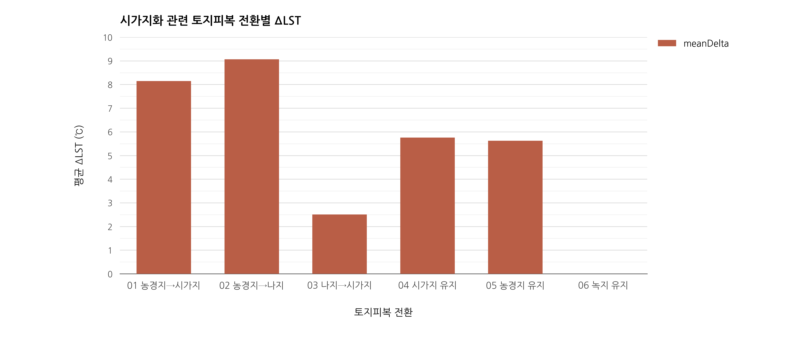

그림 6-1. 개발 전후 토지피복 전환별 평균 ΔLST (2024–2025년 − 2016–2017년, ℃). 녹지 유지의 빈칸은 산출 불가를 의미한다.

| 토지피복 전환 유형 | 분류 면적(km²) | 평균 ΔLST(℃) |
|---|---:|---:|
| 농경지→시가지 | 1.399 | +8.146 |
| 농경지→나지 | 0.436 | +9.066 |
| 나지→시가지 | 0.005 | +2.508 |
| 시가지 유지 | 0.556 | +5.761 |
| 농경지 유지 | 0.008 | +5.620 |
| 녹지 유지 | 0.000 | 산출 불가 |

표 6-1. 토지피복 전환 유형별 분류 면적 및 평균 LST 변화량

농경지에서 시가지로 전환된 면적은 1.399km², 나지로 전환된 면적은 0.436km²로 나타났다. 두 전환 유형의 합계 면적은 1.835km²로 전체 연구대상지의 약 53.19%에 해당하였다.

평균 LST 변화량은 농경지→나지에서 +9.066℃로 가장 높았으며, 농경지→시가지에서 +8.146℃로 나타났다. 시가지 유지와 농경지 유지지역에서는 각각 +5.761℃와 +5.620℃, 나지→시가지 전환 지역에서는 +2.508℃의 상승량이 나타났다. 나지→시가지와 농경지 유지지역은 분류 면적이 각각 0.005km²와 0.008km²로 작았으며, 녹지 유지지역은 해당 분류 조건에서 확인되지 않아 평균 LST 변화량을 산출하지 못하였다.

#### 6.1.2 토지피복 유지지역 기준 상대적 LST 변화

개발 전후 시가지 유지지역과 농경지 유지지역의 평균 LST 상승량은 각각 +5.761℃와 +5.620℃로, 두 유형 간 차이는 0.141℃였다. 개발 전후 토지피복 유형이 변하지 않은 시가지와 농경지에서 유사한 지표온도 상승폭이 나타났다는 점에 주목하였다. 지표온도 변화에는 NDBI 외에도 기상 조건, 토양수분, 식생 상태 등 다양한 요인이 영향을 미칠 수 있으나, 본 연구에서는 두 값의 산술평균을 지구온난화 등의 영향을 포함하는 지역적 배경 온도 상승량의 탐색적 근삿값으로 설정하였다.

ΔLST배경 = (5.761 + 5.620) / 2 = 5.6905℃

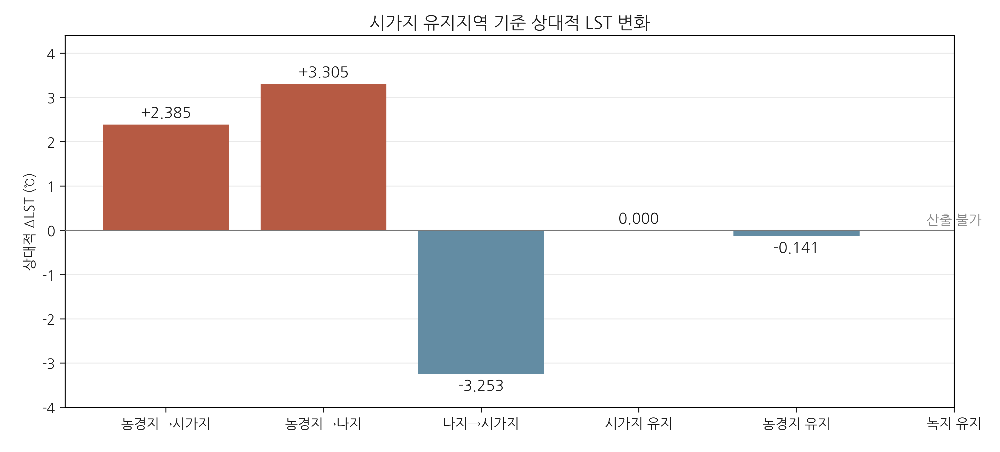

그림 6-2. 토지피복 유지지역 평균 상승량(5.6905℃) 차감 후 상대적 LST 변화량

기준값을 차감한 결과, 농경지→시가지와 농경지→나지의 상대적 온도 상승량은 각각 **+2.456℃와 +3.376℃**로 나타났다. 나지→시가지 전환 지역은 −3.183℃, 시가지 유지지역은 +0.071℃, 농경지 유지지역은 −0.071℃였다. 녹지 유지지역은 산출되지 않았다. 음의 상대적 변화량은 실제 온도가 하락했다는 의미가 아니라 기준값보다 상승폭이 작았음을 의미한다.

기준값에는 촬영일의 기상 조건과 토지피복 내부의 환경 변화도 포함될 수 있고 농경지 유지지역의 면적도 작으므로, 지구온난화에 의한 순수 상승량으로 확정하지 않고 탐색적 비교 기준으로 활용하였다.

#### 6.1.3 NDBI 수준별 개발 전후 평균 LST

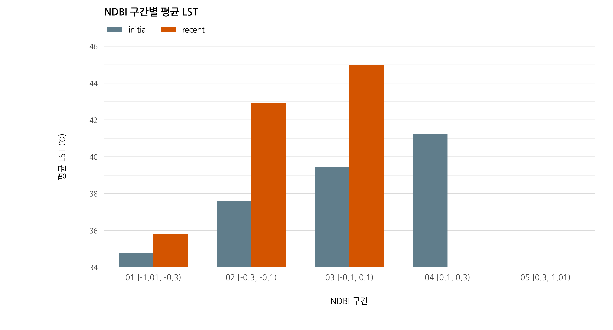

그림 6-3. NDBI 구간별 개발 전후 평균 LST (initial: 2016–2017년, recent: 2024–2025년; ℃). 빈칸은 산출 불가를 의미한다.

두 시기 모두 유효한 NDBI 구간에서 NDBI가 높을수록 평균 LST가 높게 나타났다. −1.01~−0.3 구간의 평균 LST는 개발 전 34.767℃에서 개발 후 35.790℃로 1.023℃ 높아졌다. −0.3~−0.1 구간에서는 37.613℃에서 42.933℃로 5.320℃, −0.1~0.1 구간에서는 39.441℃에서 44.972℃로 5.531℃ 높아졌다.

0.1~0.3 구간은 개발 전 41.245℃였으나 개발 후에는 평균 LST가 산출되지 않았으며, 0.3~1.01 구간은 두 시기 모두 산출되지 않았다. 각 구간은 하한을 포함하고 상한을 제외한다. 개발 후 −0.1~0.1 구간의 평균 LST는 −1.01~−0.3 구간보다 9.182℃ 높았다. 각 시기의 구간별 평균값 차이는 동일 위치의 ΔLST와 구분된다.

#### 6.1.4 NDBI 변화량과 LST 변화량의 상관 및 회귀분석

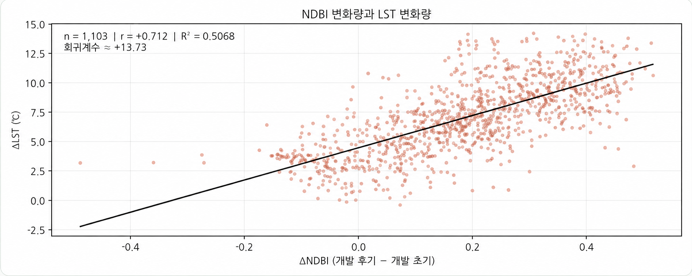

그림 6-4. ΔNDBI–ΔLST 산점도 및 최소제곱 회귀직선 (GEE Console의 실제 표본 표시값을 이용하여 작성)

1,103개의 유효 공간 표본을 대상으로 피어슨 상관분석과 최소제곱법 기반 단순선형회귀분석을 실시하였다. 분석 결과, 피어슨 상관계수는 **+0.712**, 회귀계수는 약 +13.73, 결정계수는 0.5068이었다. ΔNDBI가 0.1 증가할 때 예측되는 ΔLST는 약 1.373℃ 증가하였다.

ΔNDVI와 ΔLST의 피어슨 상관계수는 −0.678, ΔMNDWI와 ΔLST의 상관계수는 +0.187이었다. 세 지수 중 ΔNDBI가 ΔLST와 가장 높은 절댓값의 상관계수를 나타냈다. 이를 근거로 세부목적 2·3에서는 NDBI를 추가 설명변수로 사용하였으며, 각 분석에서 회귀계수를 독립적으로 추정하였다.

### 6.2 세부목적 2 · 수변 거리별 LST 및 NDBI 보정

#### 6.2.1 개발 전후 수변 거리별 평균 LST

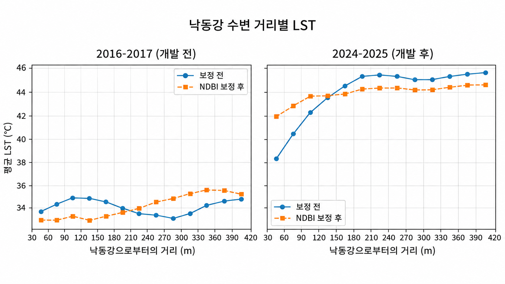

그림 6-5. 개발 전후 수변 거리별 관측 LST(Raw LST)와 NDBI 보정 LST(NDBI-adjusted LST). 구름 피복률 20% 이하, 육상 LST 및 수역 제외 주변 NDBI 기준. 거리축은 명목상 30m 구간 중심값이며, 마지막 구간은 실제 분석 상한 400m에서 절단된다.

개발 전 관측 평균 LST는 30–60m 구간에서 33.681℃, 90–120m 구간에서 34.866℃, 270–300m 구간에서 33.055℃로 나타났으며, 거리에 따른 일관된 온도 상승 경향은 확인되지 않았다. 개발 후에는 30–60m 구간에서 38.344℃, 180–210m 구간에서 45.347℃로 나타나 7.003℃의 차이를 보였다. NDBI 통제 후 동일한 두 구간의 평균 LST는 각각 41.949℃와 44.265℃로, 온도 차이는 2.316℃로 감소하였다.

#### 6.2.2 개발 전후 NDBI 통제에 따른 거리계수

개발 전 NDBI 통제 전 거리계수는 −0.074℃/100m(95% 신뢰구간: −0.866~+0.718), 수역 제외 NDBI 통제 후에는 +0.863℃/100m(95% 신뢰구간: +0.301~+1.425)로 나타났다. 통제 전에는 거리계수의 방향이 통계적으로 명확하지 않았으나, 통제 후에는 유의한 양의 관계가 확인되었다.

개발 후에는 통제 전 +1.707℃/100m(95% 신뢰구간: +1.369~+2.044), 수역 제외 NDBI 통제 후 +0.596℃/100m(95% 신뢰구간: +0.241~+0.951)가 산출되었다. 기존 수역 포함 NDBI 민감도 분석에서는 +0.419℃/100m(95% 신뢰구간: +0.072~+0.766)였다.

| 구분 | 통제 전 | 통제 후: 수역 제외 | 통제 후: 수역 포함(기존 분석) |
|---|---|---|---|
| 2016–2017 | −0.074 (−0.866~+0.718) | +0.863 (+0.301~+1.425) | +0.222 (−0.376~+0.820) |
| 2024–2025 | +1.707 (+1.369~+2.044) | +0.596 (+0.241~+0.951) | +0.419 (+0.072~+0.766) |

표 6-2. 수변 거리 회귀계수 및 95% 신뢰구간 (단위: ℃/100m)

수역 포함 여부는 주변 평균 NDBI 산출 시 수역 포함 여부를 의미하며, LST 분석 대상에서는 수역을 제외하였다. 기본 분석의 개발 전후 유효 픽셀은 각각 953개와 950개, 공간 블록은 57개와 59개였으며, NDBI 회귀계수는 각각 +37.2472와 +20.6681이었다. 개발 후에는 두 NDBI 산출 조건 모두 95% 신뢰구간이 0을 포함하지 않았다.

### 6.3 세부목적 3 · 녹지 경계 거리별 냉각 효과

개발 전에는 유효 픽셀이 확보되지 않아 거리별 평균 LST와 회귀계수를 산출하지 못하였다. 따라서 개발 후 251개의 유효 픽셀을 대상으로 분석한 결과만 제시하였다.

#### 6.3.1 NDBI 통제 전후 녹지 거리–온도 회귀분석

#### 6.3.1 NDBI 통제 전후 녹지 거리–온도 회귀분석

녹지 경계로부터의 거리와 LST 사이의 관계를 확인하기 위해 회귀분석을 실시하였다. 분석 결과, NDBI 통제 전 거리 회귀계수는 +0.726℃/100m(95% 신뢰구간: −0.062~+1.515), 통제 후에는 +0.581℃/100m(95% 신뢰구간: −0.194~+1.356)로 나타났다.

  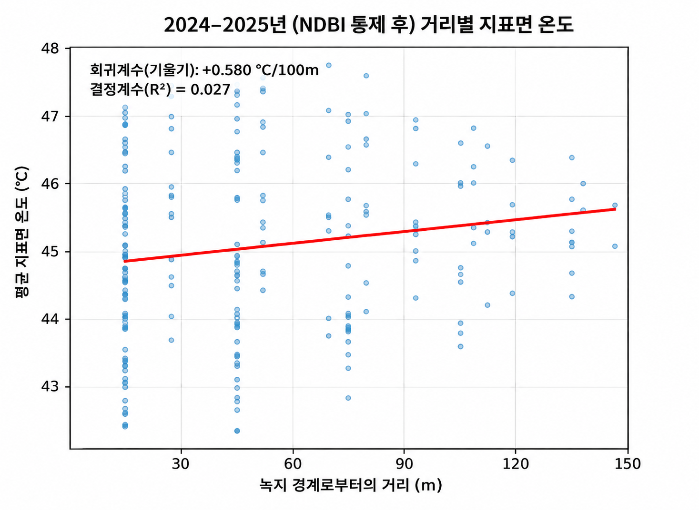

그림. 개발 후 녹지 경계 거리와 NDBI 보정 LST의 산점도 및 회귀직선

NDBI 통제 후 산점도에서는 녹지 경계로부터 멀어질수록 지표온도가 증가하는 경향이 나타났다. 결정계수(R²)는 0.027로, 거리와 보정 LST 사이의 선형회귀모형은 전체 온도 변동의 약 2.7%를 설명하였다. 또한 거리 회귀계수의 95% 신뢰구간이 0을 포함하므로 통계적으로 유의한 양의 관계는 확인되지 않았다.
#### 6.3.2 녹지 경계 거리별 평균 LST 및 냉각 영향 범위

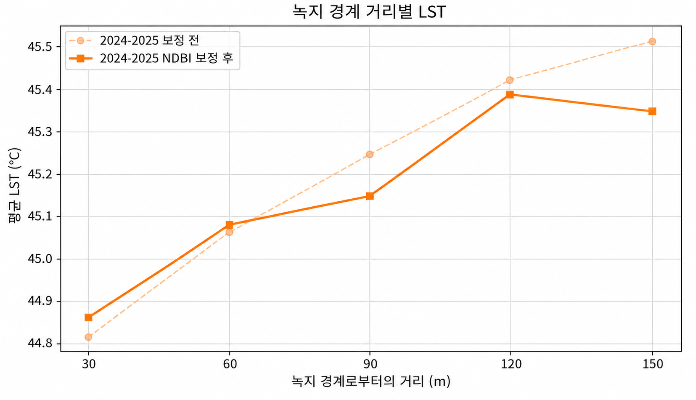

그림 6-6. 개발 후 녹지 경계 거리별 관측 평균 LST와 NDBI 보정 평균 LST (거리축은 30m 구간 중심값, ℃)

통제 전 평균 LST는 0–30m, 30–60m, 60–90m, 90–120m, 120–150m 구간에서 각각 44.823℃, 45.066℃, 45.248℃, 45.419℃, 45.507℃로 증가하여 첫 구간과 마지막 구간 사이에 0.684℃의 차이를 나타냈다. 각 구간의 유효 픽셀 수는 순서대로 103개, 65개, 38개, 33개, 12개였다.

NDBI 통제 후에는 같은 구간 순으로 44.868℃, 45.088℃, 45.158℃, 45.392℃로 증가하였으며, 120–150m 구간에서는 45.359℃로 소폭 감소하였다. 0–30m와 90–120m 구간의 보정 평균 LST 차이는 0.524℃였으며, 이후 구간에서는 0.033℃ 감소하였다.

## 7. 토의

## 8. 결론

 

---

## 연구 배경 참고문헌

기상청. (2023). <em>기후분석정보 2023년 8월호</em>. <a href="https://www.kma.go.kr/download_02/ellinonewsletter_2023_08.pdf" target="_blank">https://www.kma.go.kr/download_02/ellinonewsletter_2023_08.pdf</a>  

질병관리청. (2024). <em>2023년 온열질환 응급실감시체계 운영 결과</em>. 주간 건강과 질병, 17(34). <a href="https://www.phwr.org/journal/view.html?doi=10.56786/PHWR.2024.17.34.1" target="_blank">https://doi.org/10.56786/PHWR.2024.17.34.1</a>  

통계청. (2023). <em>2023 고령자 통계보고서pdf</em>.  

기후에너지환경부. (2023). <em>국가 기후위기 적극 대응 대책(제4차 국가 기후위기 적응대책) - 기후 상세 - 정책정보</em>. <a href="https://www.mcee.go.kr" target="_blank">https://www.mcee.go.kr</a>  

Weng, Q. (2001). A remote sensing-GIS evaluation of urban expansion and its impact on surface temperature in the Zhujiang Delta, China. <em>International Journal of Remote Sensing</em>, 22, 1999-2014. - References - Scientific Research Publishing. <a href="https://www.scirp.org" target="_blank">https://www.scirp.org</a>  

부산광역시. (연도미상). <em>부산 에코델타시티 스마트시티 조성사업</em>. 부산광역시 공식 포털사이트. <a href="https://www.busan.go.kr" target="_blank">https://www.busan.go.kr</a>  

Kirschner, V., Moravec, D., Macků, K., Kozhoridze, G., & Komárek, J. (2024). Comparing the effects of green and blue bodies and urban morphology on land surface temperatures close to rivers and large lakes. *Land, 13*(2), 162. https://doi.org/10.3390/land13020162
